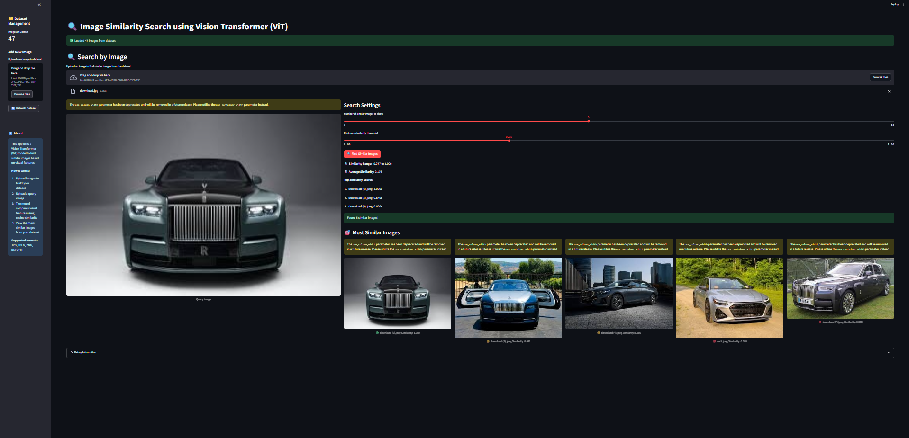
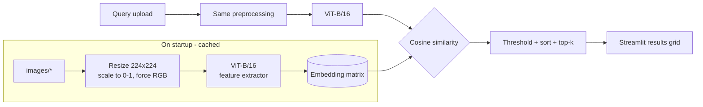

<div align="center">

# Image-Similarity

**Show it a picture. It finds the ones that look alike, using Vision Transformer embeddings.**




</div>

---

## What it does

A Streamlit app for content-based image search. Upload a query image and the app ranks every image in the local `images/` folder by visual similarity, using feature vectors from a pretrained **ViT-B/16** model on TensorFlow Hub and **cosine similarity** to compare them.

- Upload a query image (JPG, JPEG, PNG, BMP, TIFF)
- Choose how many results to show (top-k, up to 10) and a minimum similarity threshold
- See the top matches with their scores, colour-coded high / medium / low
- Grow the dataset from the sidebar by uploading new images, then hit **Refresh Dataset**

The repo includes a small sample gallery of ~47 images in `images/` so it works out of the box.

## How it works



1. The model `sayakpaul/vit_b16_fe/1` is loaded once from TensorFlow Hub (`st.cache_resource`).
2. Every image in `images/` is preprocessed and embedded; the result is cached with `st.cache_data`.
3. The query image goes through the same pipeline.
4. Scikit-learn's `cosine_similarity` scores it against all dataset embeddings.
5. Results above the threshold are sorted and the top-k are displayed. If nothing clears the threshold, the best matches are shown anyway.

## Tech stack

- **Model:** Vision Transformer ViT-B/16 feature extractor (TensorFlow Hub)
- **Framework:** TensorFlow, TensorFlow Hub
- **Similarity:** scikit-learn `cosine_similarity`, NumPy
- **Imaging:** Pillow
- **UI:** Streamlit

## Project structure

```text
Image-Similarity/
├── app.py        # the whole app: model loading, embedding, search, UI
├── images/       # searchable image gallery (add your own here)
└── demo.png      # screenshot used above
```

## Quickstart

```bash
git clone https://github.com/nabeelalikhan0/Image-Similarity.git
cd Image-Similarity

python -m venv .venv
# Windows: .venv\Scripts\activate    macOS/Linux: source .venv/bin/activate
pip install streamlit tensorflow tensorflow-hub scikit-learn numpy pillow

streamlit run app.py
```

On first launch the ViT weights are downloaded from TensorFlow Hub and every image in `images/` is embedded, so the first load takes a moment. After that, the cache makes searches fast.

To use your own gallery, drop images into `images/` (or upload them from the sidebar) and click **Refresh Dataset**.

## Notes

- Embeddings are recomputed from the images when the cache is cleared; they are not saved to disk.
- Similarity is purely visual (global ViT features), so it matches on overall appearance and composition rather than on labels or text.

---

<div align="center">

Built by [Nabeel Ali Khan](https://github.com/nabeelalikhan0) · [ChanakyaAI](https://www.chanakyaai.in)

</div>
